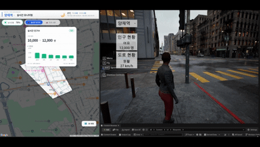

# 디지털트윈을 위한 실시간 데이터 동기화 파이프라인

<p align="center">
  
</p>

<br>

## 1. 프로젝트 개요

### 배경
- 현재 디지털 트윈 기술은 시각적 가시화(Unity, Unreal)에 집중되어 있어, 현실 데이터와의 동기화가 미비한 실정입니다.<br><br>
- 본 프로젝트는 이 문제를 개선하고자 **서울시 공공 데이터를 실시간으로 수집·가공하여 DB에 동기화하는 데이터 파이프라인**을 개발하였습니다.<br><br>

### 개발 목표
- 여러 타입 데이터(교통 돌발상황, 인구, 도로 소통, 기상, 지하철 등)의 실시간 수집 및 동기화<br><br>

### 핵심 성과
- 데이터 발생부터 적재까지 평균 레이턴시 **1.2초~1.8초**<br><br>
- 서비스별 데이터 갱신 지연을 점수화한 **실시간율** 지표를 대시보드에 표시하여 동기화 상태를 판단<br><br>
- 수집 데이터를 UE5 오픈소스 프로젝트 `City Sample`의 차량·보행자 스폰 밀도에 연동하여 가시화<br><br><br>

## 2. 시스템 아키텍처
<br><br>

1. **Data Ingestion (Producer)**
	- 서울 열린데이터 광장 API(실시간 도시데이터, 돌발정보)를 60초 주기로 수집해 Kafka 토픽으로 발행<br>

2. **Message Broker (Kafka)**
	- 수집과 처리 사이의 버퍼 역할, 토픽 `city-data` / `traffic-incidents`<br>

3. **Stream Processing (Spark Structured Streaming)**
	- 토픽을 구독해 중첩 JSON을 파싱·평탄화한 뒤 섹션별(인구·도로·기상·지하철·문화행사 등) 테이블로 분기 적재<br>
	- 배치 내 중복은 `dropDuplicates()`, 재시작 시 재처리는 `checkpointLocation`으로 방지<br>

4. **Storage (PostgreSQL)**
	- 원본(`city_data_raw`)과 가공 테이블을 함께 보관, 승하차 인원은 트리거로 시간대별 자동 집계<br>

5. **Service (FastAPI & Dashboard)**
	- `Router - CRUD - Schema - Model` 계층의 REST API, 이를 폴링하는 HTML/JS 대시보드(Google Maps)<br>
	- UE5 측은 VaRest 플러그인으로 같은 API를 호출 (UE5 프로젝트는 본 저장소에 포함되지 않음)<br><br>

_<small>전체 시스템은 Docker Compose 위에서 서비스별 컨테이너로 동작합니다.</small>_<br><br>

## 3. 기술 스택

| 분류 | 기술 |
| :--- | :--- |
| Infra | Docker, Docker Compose |
| Data | Apache Kafka, Apache Spark (Structured Streaming) |
| Backend | Python, FastAPI, SQLAlchemy |
| DB | PostgreSQL |
| Frontend | HTML / JS / CSS, Google Maps API |
| Visualization | Unreal Engine 5 (`City Sample`, VaRest) |

<br>

## 4. 실행 방법

### 준비
- Docker Desktop 실행 후, 루트에 `.env` 파일을 만들고 아래 내용을 채웁니다.
	```
	# 서울 열린데이터 광장 (https://data.seoul.go.kr)
	SEOUL_API_KEY=

	# Google Cloud Maps API Key
	GOOGLE_MAPS_API_KEY=

	HOST_PORT_API=58000
	HOST_PORT_KAFKA=59092
	HOST_PORT_DB=54320
	HOST_PORT_SPARK_UI=58080
	```

### 실행 / 종료
```
docker compose up -d      # 실행 (kafka-setup은 토픽 생성 후 종료되는 것이 정상)
docker compose down       # 종료
docker compose down -v    # 종료 + DB 초기화 (db/init.sql 수정 시 필요)
```

### 접속
| 대상 | 주소 |
| :--- | :--- |
| 대시보드 | http://localhost |
| API 문서 (Swagger) | http://localhost:58000/docs |
| Spark Master UI | http://localhost:58080 |
| DB | `docker exec -it db psql -U user -d traffic_db` |

- 첫 데이터는 실행 후 1~2분 뒤부터 들어옵니다.

### 주요 API
| Prefix | 내용 |
| :--- | :--- |
| `/city` | 인구 현황·예측, 도로 소통, 기상 현황·예보, 문화행사, 대중교통 승하차 |
| `/subway` | 지하철 실시간 도착, 시간대별 승하차 집계 |
| `/incident` | 진행 중인 교통 돌발상황 |
| `/cctv` | CCTV 스트림 목록 (`db/init.sql`의 고정 데이터) |

- 대부분 `area_name`(예: `강남역`) 쿼리 파라미터를 받습니다. 전체 목록은 Swagger 문서를 참고하세요.

### 대상 지역 변경
1. `back_end/producer/producer_city_data.py`의 `TARGET_AREAS`에 지역 추가<br>
2. `front_end/script.js`의 `TARGET_AREA_NAME` 변경<br>
3. `docker compose restart producer` 후 1~2분 대기, 대시보드 새로고침<br>

<br>

## 5. 트러블슈팅
- **컨테이너가 포트 오류로 뜨지 않는 경우** : `.env`의 포트를 다른 값으로 변경<br><br>
- **producer 컨테이너가 바로 종료되는 경우** : `back_end/producer/start_producers.sh`가 CRLF이면 동작하지 않으므로 LF로 변경<br><br>
- **데이터가 들어오지 않는 경우** : `docker compose logs producer`로 API 응답 확인 (API 키 오류, 응답 원문 깨짐 등), 이상 없으면 `docker compose restart producer`<br><br>
- **producer에 필드를 추가하는 경우** : 서울 열린데이터 XML 태그는 소문자이므로 대소문자 확인<br><br>
